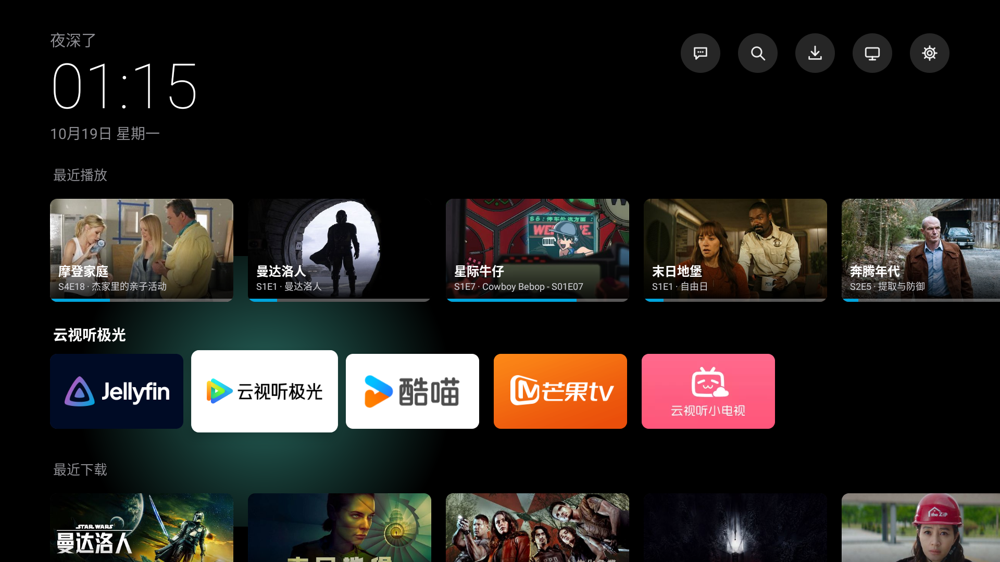
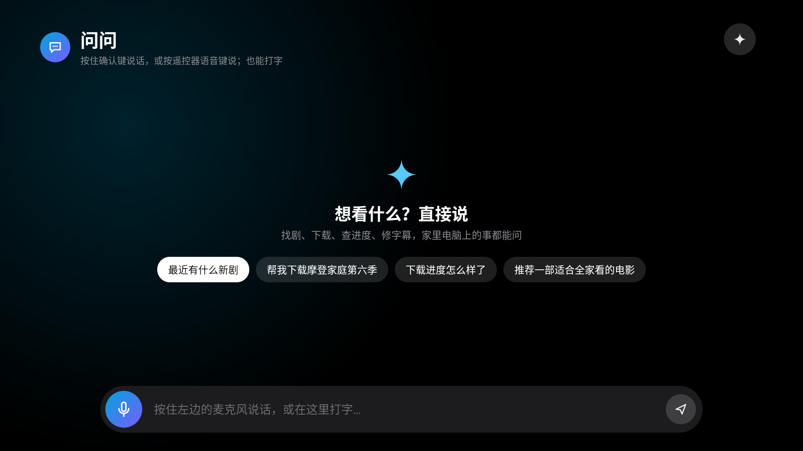

# Jellyfin AI TV Launcher

[English](README.md) | **简体中文**

一个给 Android TV / 国内小米电视用的**极简桌面**，把家里的影音服务和 AI 助手接到电视上：

- **没有广告、没有推荐位**：纯黑底，左上角时间，下面是你自己的东西
- **最近播放 / 最近下载**：直接读家里的 Jellyfin，带进度条，确认键直接开播
- **内置播放器，字幕优先**：ExoPlayer 直连 Jellyfin（放不了自动改服务器转码），续播、进度同步、自动下一集。字幕由桌面自己渲染：**遥控器现场调时间**（0.1 秒一档，可记到整季，也能让 Agent 把文件永久修正）、描边 / 半透明底 / 黑底、白 / 黄、三档字号，同时出现的几句自动合并不重叠，视频自带字幕轨（含蓝光 PGS）也能手动打开
- **问问**：和你自己的 AI Agent 对话。可以对着电视说话（按住确认键说，松手发送），也可以按遥控器语音键说（借小爱同学听写），还能打字
- **找剧 / 下载进度**：搜资源、一键下载、看进度，具体由你自己的后端实现
- **去广告脚本**：通过 ADB 停用预装的广告、统计、推送包，随时可以恢复



> 灵感来自 [tv-vibehack](https://github.com/Gathin23/tv-vibehack)：一位海外开发者用 Claude Code 给爸妈的小米电视去广告、换桌面。这个项目把同样的思路搬到了**国内版**小米电视上，并接上了家庭影音和 AI 助手。

## 这个仓库包含什么

只有**电视端**：桌面 APK 的源码，加一个 ADB 运维脚本。后端（AI Agent、语音识别、资源搜索下载）每家都不一样，这里**只给接口约定**，见 [docs/protocol.md](docs/protocol.md)。接口很简单，把这份文档交给你的 AI 编程助手，它就能照着在你自己的服务上实现出来。

```
launcher/          桌面 APK 源码（纯 Java + 平台控件，不依赖 AndroidX，不用 Gradle）
  deps.mjs         从 Maven 拉 Media3（ExoPlayer）和它的依赖，不用 Gradle
  build.mjs        一条命令打出签好名的 APK
  assets/*.example 两个配置文件模板（Jellyfin、后端网关）
tv.mjs             ADB 运维：备份、去广告、恢复、截图、启用主页键接管
disable-list.txt   去广告停用清单（只停用不卸载）
docs/
  protocol.md      后端要实现的接口（对话 / 语音识别 / 找剧 / 下载）
  jellyfin.md      Jellyfin 这边怎么配
  voice.md         语音助手怎么配（本机 Whisper）
  xiaomi-notes.md  国内版小米电视的坑和绕法（主页键、麦克风、语音键、广告包）
```

## 功能怎么拆的：都是可选的

| 你有什么 | 能用到什么 |
|---|---|
| 只有电视 | 极简桌面 + 去广告（不配任何 assets 也能用，只显示应用） |
| + Jellyfin | 首页「最近播放」「最近下载」 |
| + 你的后端网关 | 「问问」「找剧」「下载」三个入口，以及首页「下载中」 |
| + 语音识别服务 | 对着电视说话 |

没配置的功能会自动隐藏。

## 快速开始

### 1. 准备

> 打包和 ADB 脚本目前按 **Windows** 写的（`7z.exe`、`adb.exe` 的路径和默认 JDK 位置，JDK 可用 `JAVA_HOME` 覆盖）。macOS / Linux 改一下 `launcher/build.mjs` 和 `tv.mjs` 里那几处路径即可，也可以直接让 AI 助手改。

- 电视：设置 → 关于 → 连按「产品型号」7 次打开开发者模式 → 打开「ADB 调试」
- 电脑：JDK 17、Node.js 18+、7-Zip；Android SDK 只要 `build-tools;34.0.0` 和 `platforms;android-34`，放在 `tools/android-sdk`（装法见下）
- adb：`platform-tools` 放在 `tools/platform-tools`

```bash
# Android 命令行工具（只装用得到的两样，不用 Android Studio）
sdkmanager --sdk_root=tools/android-sdk "build-tools;34.0.0" "platforms;android-34"
```

### 2. 连电视、先备份

```bash
export TV_ADDR=<电视IP>:5555
node tv.mjs connect          # 电视上会弹「允许 USB 调试」，选一律允许
node tv.mjs backup           # 包列表 / 设置 / 默认桌面都存到 backup/，恢复全靠它
```

### 3. 去广告（可选）

先打开 `disable-list.txt`，按自己的需要删改，然后：

```bash
node tv.mjs disable          # 只停用（pm disable-user），不卸载
node tv.mjs restore          # 后悔了：按备份全部恢复
```

### 4. 配置并打包桌面

```bash
cd launcher
cp assets/jellyfin.properties.example assets/jellyfin.properties   # 可选，见 docs/jellyfin.md
cp assets/gateway.properties.example  assets/gateway.properties    # 可选，见 docs/protocol.md
node deps.mjs                # 只需一次：下载播放内核 Media3 及其依赖到 libs/，不用 Gradle
node build.mjs               # → out/tvhome.apk
```

### 5. 装到电视

```bash
adb -s $TV_ADDR install -r launcher/out/tvhome.apk
node tv.mjs enable-home-service    # 接管主页键 + 授予录音、读日志、使用记录权限
```

普通 Android TV 可以直接设成默认桌面。**国内版小米电视不允许第三方当默认桌面**，只能靠无障碍服务接管主页键，原理和坑见 [docs/xiaomi-notes.md](docs/xiaomi-notes.md)。

## 常用应用怎么改

首页常用应用写在 `MainActivity.java` 顶部的 `FAVORITES` 里（包名、显示名、指定入口），没装的会自动跳过。

## 截图

| 首页 | 问问 |
|---|---|
|  |  |

## 许可

MIT
